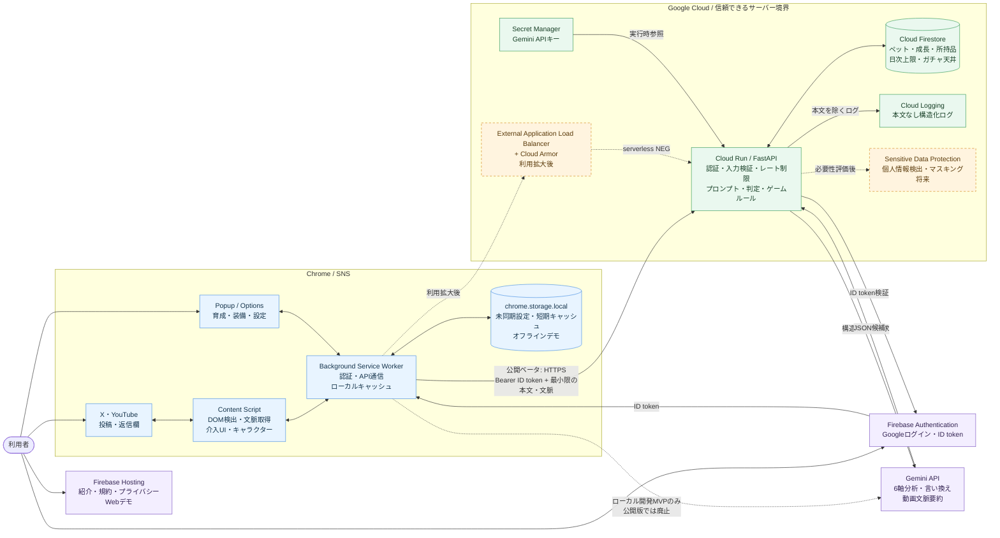
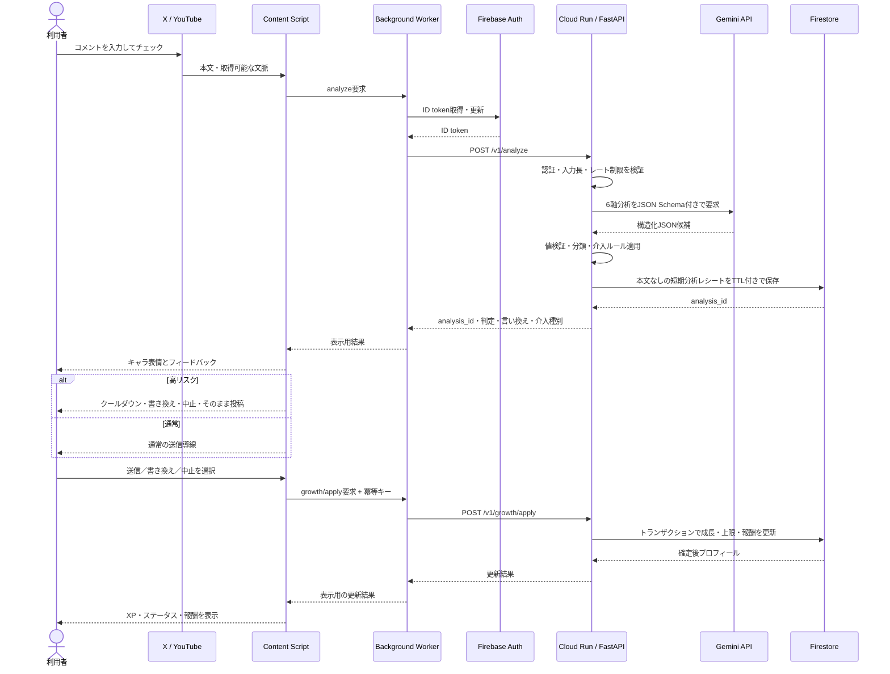

# KokoroPet 本番アーキテクチャ

この文書は旧称KokoroPet時点の公開版構想です。Commet 0.7.0ではReact + WXTのChrome拡張からNode.js + Hono APIを呼び出し、Firebase AuthenticationとFirestoreを使います。現行の構成と起動手順は [README.md](README.md) を参照してください。

- 文書バージョン: 0.1
- 対象: Chrome拡張MVP 0.5.0から公開ベータへの移行
- 更新日: 2026-11-06

## 1. 全体構成図

実線は公開ベータで使用する経路、破線はローカルMVPまたは将来導入する経路を表す。公開版ではGemini APIキーを拡張機能へ配布せず、すべてCloud Runから呼び出す。

## 2. 投稿前チェックのシーケンス

## 3. 責務分離

| レイヤー | 決めること | 決めないこと |
|---|---|---|
| Content Script | 対象入力欄、返信元の取得、UI表示、送信操作の一時停止 | AI分類、XP、ガチャ結果 |
| Background Worker | 認証状態、API通信、再試行、ローカルキャッシュ | 信頼できるゲーム状態の最終値 |
| Gemini API | 6軸スコア候補、理由、言い換え、動画要約 | 最終分類、投稿禁止、報酬量 |
| Cloud Run | 入出力検証、最終分類、介入判断、報酬・ガチャルール | SNS投稿の削除やアカウント処罰 |
| Firestore | クラウド上のゲーム状態の正本 | 投稿本文・返信元本文の保存 |

## 4. データ配置

| データ | 保存先 | 保持方針 |
|---|---|---|
| 投稿本文・返信元本文 | Cloud Runメモリ | 分析中だけ。Firestoreとログへ保存しない |
| Gemini出力 | 応答中のCloud Runメモリ | 値検証後、必要最小限の結果だけクライアントへ返す |
| ペット・XP・ステータス・所持品 | Firestore | UID単位。ゲーム状態の正本 |
| API設定・未同期設定 | `chrome.storage.local` | 端末ローカル。公開版にGemini APIキーを置かない |
| 動画要約キャッシュ | 原則ローカル、将来再評価 | 7日TTL、最大20件。本文のサーバー永続化は行わない |
| 運用ログ | Cloud Logging | 本文・プロンプト・トークン・シークレットを除外 |
| 短期分析レシート | Firestore | UID、分類、確信度、有効期限、消費済み状態のみ。本文なし、TTL削除 |
| 重複防止情報 | Firestore | イベントIDと、必要時のみ復元不能・短期TTLの文章指紋 |

## 5. セキュリティ境界

1. Content Scriptと`chrome.storage.local`は改ざんされ得るクライアント領域として扱う。
2. Cloud RunはFirebase ID token、JSONスキーマ、文字数、列挙値、冪等キーを検証する。
3. Firestoreへのゲーム状態更新はCloud Runのサービスアカウントだけが行う。
4. Gemini APIキーはSecret Managerで管理し、Cloud Runサービスアカウントに参照権限だけを与える。
5. AI出力は信頼せず、0〜10の範囲、必須項目、分類条件をCloud Runで再検証する。
6. 強い介入は高い有害性・確信度・十分な文脈がそろう場合に限定し、常に誤判定報告と最終的な投稿選択を残す。
7. Cloud Armor導入時はExternal Application Load Balancerとserverless NEGをCloud Runの前段に置き、Cloud Runのingressをロードバランサー経由へ制限する。

## 6. 導入ロードマップ

| フェーズ | 導入内容 | 完了条件 |
|---|---|---|
| 0: 現行MVP | 拡張機能、ローカル保存、Gemini直結、APIなしデモ | ローカルでX／YouTubeモックを体験できる |
| 1: 安全な公開ベータ | Firebase Auth、Cloud Run、Secret Manager、Gemini | 拡張にAPIキーを置かず、認証済み分析ができる |
| 2: 同期と不正対策 | Firestore、ゲーム状態正本、冪等性、日次上限 | 複数端末でも二重報酬や残高改ざんが起きない |
| 3: 公開運用 | Firebase Hosting、Cloud Logging、アラート、規約 | 公開情報と障害監視がそろう |
| 4: 利用拡大 | Load Balancer、Cloud Armor、必要に応じてSensitive Data Protection | 負荷・攻撃・個人情報リスクの評価基準を満たす |

## 7. 設計判断

- Firebase Hostingは拡張機能本体の配布先ではなく、紹介、規約、プライバシーポリシー、Webデモに使用する。拡張機能本体はChromeウェブストアで配布する。
- Firebase Authenticationは公開ベータのクラウド分析と同期で必須とし、APIなしデモはログイン不要で残す。
- Cloud ArmorはCloud Runへ直接付けるのではなく、External Application Load Balancerを経由して適用する。
- Sensitive Data Protectionは全リクエストへ初日から適用せず、検出対象、精度、遅延、費用を評価してから導入する。
- ユーザーが投稿した事実を拡張機能だけで完全には証明できないため、報酬不正対策は冪等性、活動日上限、類似文除外、短期イベント履歴を組み合わせる。

## 8. 参考資料

- [Cloud Run: Authenticating users](https://docs.cloud.google.com/run/docs/authenticating/end-users)
- [Cloud Run: Configure secrets for services](https://docs.cloud.google.com/run/docs/configuring/services/secrets)
- [Gemini API: Structured outputs](https://ai.google.dev/gemini-api/docs/structured-output)
- [Cloud Armor: Integrate with other Google products](https://docs.cloud.google.com/armor/docs/integrating-cloud-armor)
- [Sensitive Data Protection: De-identifying sensitive data](https://docs.cloud.google.com/sensitive-data-protection/docs/deidentify-sensitive-data)
- [Cloud Logging: Structured logging](https://docs.cloud.google.com/logging/docs/structured-logging)
